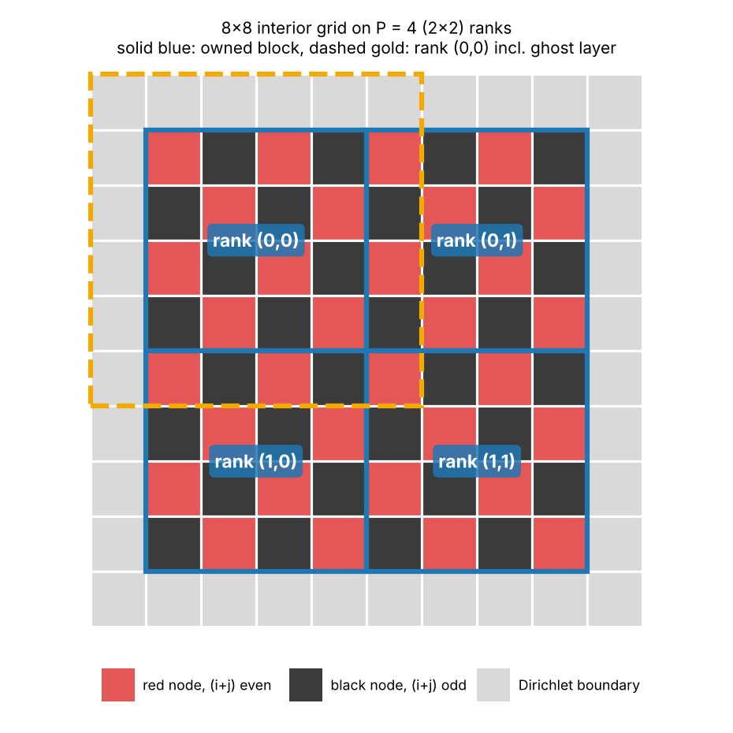
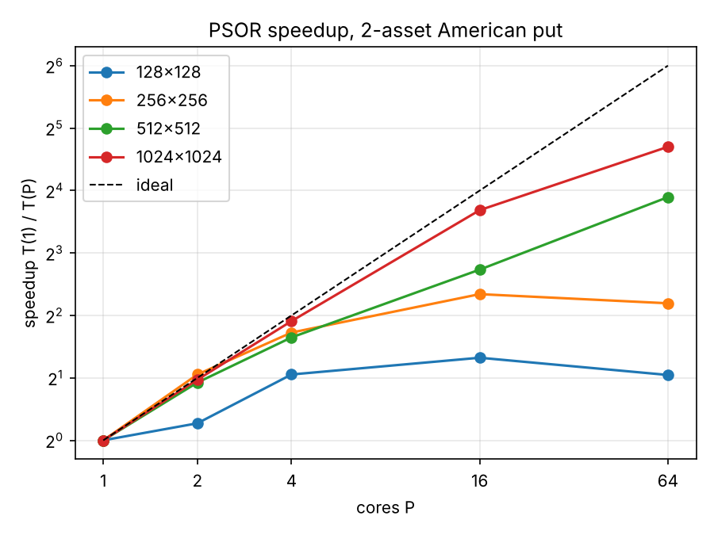

# Parallel American Option Pricing by Projected SOR #

AMS 530 Project 3, Stony Brook Graduate School

Supervisor: Professor Yuefan Deng, AMS Department, Stony Brook University

## Project Description ##
This project prices an American option on two assets by solving the Black-Scholes PDE on a 2D grid. I parallelized the solver with MPI and ran the experiments on the SeaWulf supercomputer cluster.

At each time step, the PDE produces a sparse system with a five-point finite-difference stencil. I solve each system using projected successive over-relaxation (PSOR), which applies the payoff constraint through a `max()` operation after every update. The solver uses 2D domain decomposition and red-black ordering. I tested all combinations of `N = {128, 256, 512, 1024}` and `P = {1, 2, 4, 16, 64}`, where N is the number of interior grid nodes per side and P is the number of MPI processes. I checked the results against a serial run and against the closed-form price of the corresponding European option.

## Problem Statement ##
Problem 3.5 (contributed by A.W.): Pricing of 2-Asset American Options by Projected SOR.

The value V(S₁, S₂, t) of an American option on two uncorrelated assets satisfies the Black–Scholes PDE

$$\frac{\partial V}{\partial t} + \frac{1}{2}\sigma_1^2 S_1^2 \frac{\partial^2 V}{\partial S_1^2} + \frac{1}{2}\sigma_2^2 S_2^2 \frac{\partial^2 V}{\partial S_2^2} + rS_1\frac{\partial V}{\partial S_1} + rS_2\frac{\partial V}{\partial S_2} - rV = 0$$

Discretized with the five-point stencil of Problem 3.4, it yields a sparse system of the same structure. Unlike 3.4, the solver marches backward in time and solves one such system per time step. Solve each system by projected SOR: after every update, set

$$V_{ij} \leftarrow \max(V_{ij}, \Phi_{ij})$$

where Φ is the payoff. This step enforces the holder's right to exercise early.

Tasks:

(1) Parallelize each solve with 2D domain decomposition and red–black ordering, as in 3.4.

(2) Run meshes of 128×128 and larger on P = 1, 2, 4, 16 (and 64) cores, and plot the speedup curves.

(3) Verify correctness against a serial run and against the closed-form European price, obtained by skipping the max() step.

## Algorithm Design ##

### Model ###
The option is a put on the geometric average of the two assets, $\Phi = \max(K - \sqrt{S_1 S_2},\ 0)$. I chose this payoff because, with uncorrelated assets, $\sqrt{S_1 S_2}$ is lognormal, so the European version has a Black-Scholes closed form to verify against.

The PDE is solved in log prices $x = \ln S_1$, $y = \ln S_2$ and time to expiry $\tau = T - t$:

$$u_\tau = a_1 u_{xx} + a_2 u_{yy} + b_1 u_x + b_2 u_y - ru, \quad a_i = \tfrac{1}{2}\sigma_i^2, \quad b_i = r - \tfrac{1}{2}\sigma_i^2$$

In log space every coefficient is constant, so the stencil weights are the same at every node.

| Parameter | Value |
| -------- | -------- |
| $S_{1,0}, S_{2,0}$ | 100, 100 |
| $K$ | 100 |
| $r$ | 0.05 |
| $\sigma_1, \sigma_2$ | 0.30, 0.20 |
| $T$ | 1 year |
| Domain | $\pm 5\sigma_i\sqrt{T}$ around the spot |
| Time steps $M$ | 100 |
| Tolerance | max change per iteration $< 10^{-8}$ |

### Discretization ###
Time uses implicit (backward) Euler and space uses central differences on an $N \times N$ interior grid, giving one system per time step:

$$c_0 u_{ij} - c_{x+} u_{i+1,j} - c_{x-} u_{i-1,j} - c_{y+} u_{i,j+1} - c_{y-} u_{i,j-1} = u^{\text{old}}_{ij}$$

$$c_0 = 1 + \Delta\tau\left(\frac{2a_1}{h_x^2} + \frac{2a_2}{h_y^2} + r\right), \quad c_{x\pm} = \Delta\tau\left(\frac{a_1}{h_x^2} \pm \frac{b_1}{2h_x}\right)$$

and likewise for $c_{y\pm}$. All neighbor weights are positive for the tested grids, so the matrix is strictly diagonally dominant and SOR converges. Implicit Euler stays smooth near the payoff kink, at the cost of first-order accuracy in time.

Boundaries use Dirichlet values (the closed-form European price, or $\max(\text{European}, \Phi)$ for American runs), and the center node sits exactly on $(S_{1,0}, S_{2,0})$, so the price is read straight off the grid.

### Projected SOR ###
Each node is updated with the Gauss-Seidel value, over-relaxed, then clamped to the payoff:

$$\tilde{u} = \frac{u^{\text{old}}_{ij} + c_{x+}u_{i+1,j} + c_{x-}u_{i-1,j} + c_{y+}u_{i,j+1} + c_{y-}u_{i,j-1}}{c_0}, \quad u_{ij} \leftarrow \max\left(u_{ij} + \omega(\tilde{u} - u_{ij}),\ \Phi_{ij}\right)$$

Iterations repeat until the largest change is below the tolerance, starting from the previous time step's solution. Instead of tuning $\omega$, I used Young's formula, which applies since red-black ordering is consistently ordered:

$$\rho_J = \frac{2\left(\sqrt{c_{x+}c_{x-}} + \sqrt{c_{y+}c_{y-}}\right)\cos\left(\frac{\pi}{N+1}\right)}{c_0}, \quad \omega^* = \frac{2}{1 + \sqrt{1 - \rho_J^2}}$$

This gives $\omega$ = 1.217, 1.460, 1.677, 1.823 for N = 128, 256, 512, 1024.

### Data Distribution ###
The P ranks form a $p_x \times p_y$ Cartesian grid (`MPI_Cart_create`), so P = 2, 4, 16, 64 give 2×1, 2×2, 4×4 and 8×8. Each rank has an equal block of the grid plus one layer of ghost nodes holding its neighbors' edge values.



In the five-point stencil, every neighbor of a red node is black and vice versa, so all red nodes are updated in parallel, the edges are exchanged, then all black nodes. The color comes from global indices, $(i + j) \bmod 2$, so every rank agrees on the checkerboard. Since update order within a color doesn't matter, the result is the same for any P.

### Load Balancing & Communication ###
Every block is the same size and all ranks stop on the same global convergence test, so every rank does the same work. The moving early-exercise region only changes whether the `max()` is active, not the cost of a node, so dynamic load balancing is not needed.

| Phase | Style | Per-Rank Data Size | Per Iteration |
| -------- | -------- | -------- | -------- |
| Halo exchange after each color sweep | `MPI_Sendrecv` with 4 neighbors | 4 edges of ~$N/\sqrt{P}$ doubles | 2 |
| Convergence check | `MPI_Allreduce(MAX)` | 1 double | 1 |

Columns are sent with an `MPI_Type_vector`, and ranks on the physical boundary have `MPI_PROC_NULL` neighbors. The communication-to-computation ratio per rank is

$$\frac{\text{comm}}{\text{comp}} \propto \frac{4N/\sqrt{P}}{N^2/P} = \frac{4\sqrt{P}}{N}$$

so larger meshes should scale better, while the MPI allreduce adds a latency cost every iteration that doesn't shrink with N.

### Pseudocode ###

```
MPI_Init()
read N, M, reps
coef = stencil(N, M)          //c0, cx+, cx-, cy+, cy-
omega = optimal_omega(coef)
create px x py cart grid, find neighbors
allocate u, rhs, payoff g    //(nx+2) x (ny+2) incl. ghosts

FUNCTION solve():
    u = g                    //value at expiry is the payoff
    MPI_Barrier()
    FOR step = 1, M:
        set_boundary(tau = step * dt)
        rhs = u
        DO:
            d_red = sweep(color = red)     //SOR update then max(u, g)
            exchange_halos()
            d_black = sweep(color = black)
            exchange_halos()
            d = MPI_Allreduce(MAX, max(d_red, d_black))
        WHILE d >= tol
    t_total = MPI_Allreduce(MAX, wall time)
    price = u at center node
    RETURN times, price

FOR rep = 1, reps:
    solve()
    IF rank == 0:
        print and write CSV row
```

## Repo Structure ##
```
AmericanSOR/
├── src/
│   ├── main.c             # Args, output CSV, repetitions
│   ├── psor.c             # Stencil, optimal omega, red-black PSOR sweep, time loop
│   ├── psor.h
│   ├── grid.c             # Cartesian decomposition, boundary, halo exchange
│   ├── grid.h
│   ├── black_scholes.c    # Payoff and closed form European price
│   ├── black_scholes.h
│   └── params.h           # Model and stencil structs
│
├── Make/
│   └── Makefile
├── Python/
│   └── plot_results.py    # Plots and summary tables
├── Images/                # Images for README
├── Bash/
│   └── run.sh             # Full experiment
│
├── README.md
└── .gitignore
```

## Compilation & Execution ##

> Run from repo root

```
sbatch Bash/run.sh
```

The script builds on the compute node, runs every (N, P) combination 3 times plus the European check, and writes everything to `results/<jobid>/`. The general structure is

```
module load gcc/13.2.0
module load openmpi/gcc13.2/4.1.6

make -f Make/Makefile

mpirun --bind-to core --map-by core -np P ./psor -n N -m 100 -r 3 -o american.csv
```

| Flag | Meaning |
| -------- | -------- |
| `-n` | Interior nodes per side (N) |
| `-m` | Time steps (M), default 100 |
| `-r` | Number of timed repetitions |
| `-e` | European mode, skips the `max()` |
| `-w` | Fix $\omega$ instead of using the optimal value |
| `-t` | Convergence tolerance, default $10^{-8}$ |
| `-o` | Output CSV name |

Plots and tables are made with `python Python/plot_results.py results/<jobid>`.

### Experiment Structure ###

|  |  |
| -------- | -------- |
| Partition | short-96core |
| Node | AMD EPYC 7643, 2 × 48 cores |
| Compiler | GCC 13.2.0, `-O3 -march=native -ffp-contract=off` |
| MPI | OpenMPI 4.1.6, `--bind-to core --map-by core` |
| Repetitions | 3 per (N, P), medians reported |
| Timing | Maximum time across ranks of the full time-stepping loop |
| Serial Baseline | P = 1 run of the same program (all neighbors `MPI_PROC_NULL`) |

## Results ##

### Correctness ###

For every mesh size, all 15 runs (5 values of P × 3 repetitions) gave the same price and iteration count, and a hash of the full grid confirmed the parallel solution is bitwise identical to the serial one.

| N | Iterations (all P) | Price (all P) |
| -------- | -------- | -------- |
| 128 | 1300 | 5.7861 |
| 256 | 2351 | 5.7876 |
| 512 | 4380 | 5.7879 |
| 1024 | 8299 | 5.7880 |

Against the closed-form European price of 5.4378 (N = 512, P = 16, run with `-e`):

| M | Numerical | Error |
| -------- | -------- | -------- |
| 100 | 5.4288 | 0.008984 |
| 400 | 5.4355 | 0.002305 |

4x more time steps gives 3.9x less error, as expected for first-order implicit Euler, so the remaining error comes from time stepping, not the solver. The American price is about 0.35 higher than the European, which is the early-exercise premium, and each doubling of N changes it about a quarter as much as the last (0.001442, 0.000360, 0.000088), consistent with second-order central differences.

### Execution Time ###

All times in ms.

| N | Serial | $P = 2$ | $P = 2^2$ | $P = 2^4$ | $P = 2^6$ |
| -------- | -------- | -------- | -------- | -------- | -------- |
| $2^7$ | 75.607 | 62.584 | 36.404 | 30.228 | 36.607 |
| $2^8$ | 463.141 | 223.030 | 140.005 | 91.410 | 101.178 |
| $2^9$ | 2616.748 | 1378.004 | 834.908 | 393.395 | 175.954 |
| $2^{10}$ | 19307.412 | 9849.227 | 5140.263 | 1499.849 | 742.548 |

### Speedup ###
$S = T(N,1) / T(N,P)$

| N | $P = 2$ | $P = 2^2$ | $P = 2^4$ | $P = 2^6$ |
| -------- | -------- | -------- | -------- | -------- |
| $2^7$ | 1.208x | 2.077x | 2.501x | 2.065x |
| $2^8$ | 2.077x | 3.308x | 5.067x | 4.577x |
| $2^9$ | 1.899x | 3.134x | 6.652x | 14.872x |
| $2^{10}$ | 1.960x | 3.756x | 12.873x | 26.002x |



### Efficiency ###
$E = S/P$

| N | $P = 2$ | $P = 2^2$ | $P = 2^4$ | $P = 2^6$ |
| -------- | -------- | -------- | -------- | -------- |
| $2^7$ | 0.604 | 0.519 | 0.156 | 0.032 |
| $2^8$ | 1.038 | 0.827 | 0.317 | 0.072 |
| $2^9$ | 0.949 | 0.784 | 0.416 | 0.232 |
| $2^{10}$ | 0.980 | 0.939 | 0.805 | 0.406 |

For $N = 2^{10}$, scaling is close to linear up to 16 cores and reaches 26x on 64. For $N = 2^7$ and $2^8$, P = 16 is faster than P = 64, since each rank has too little work to cover the communication.

## Performance Analysis ##

### Communication vs Computation ###
Share of total time spent in halo exchanges and the MPI allreduce:

| N | $P = 2$ | $P = 2^2$ | $P = 2^4$ | $P = 2^6$ |
| -------- | -------- | -------- | -------- | -------- |
| $2^7$ | 13.309% | 34.485% | 78.656% | 94.484% |
| $2^8$ | 11.884% | 19.358% | 56.039% | 88.909% |
| $2^9$ | 4.123% | 15.762% | 37.798% | 58.312% |
| $2^{10}$ | 1.058% | 4.707% | 17.475% | 38.247% |

This follows the $4\sqrt{P}/N$ ratio: the share falls as N grows and rises as P grows. At P = 64, communication takes about 20–40 µs per iteration for every mesh size, while compute per iteration ranges from about 1.5 µs at $N = 2^7$ to 55 µs at $N = 2^{10}$. The messages are small enough at that point (128 doubles per edge at $N = 2^{10}$) that the cost is mostly fixed latency, and only the largest mesh has enough compute to stay ahead of it.

### Iterations & Load Balance ###
Iterations per time step roughly double each time N doubles (13, 24, 44, 83), matching the $O(N)$ growth of optimally tuned SOR, compared with $O(N^2)$ for plain Gauss-Seidel. The count is the same for every P, so it doesn't affect speedup.

The slowest rank's compute time stayed between 1.00 and 1.25 times the average in every run. Since the work per rank is identical, that variation is most likely from hardware effects such as cache and clock speed, and the moving early-exercise boundary caused no noticeable imbalance.

### Run-to-Run Variance ###
Since I was using median values, I did not use an untimed warmup, and the first repetition was often the slowest (serial $N = 2^8$: 652.739, 463.141, 353.881 ms), possibly from CPU frequency ramp-up. This likely also explains the E = 1.038 at $(2^8, 2)$.

### Scalability ###
- Speedup increases as the block size $N/\sqrt{P}$ increases
- Communication per rank scales with $N/\sqrt{P}$, computation with $N^2/P$
- Every iteration has a fixed latency cost (2 halo exchanges and an MPI allreduce) that limits efficiency for small meshes
- Time steps are sequential, so all parallel speedup comes from within each solve